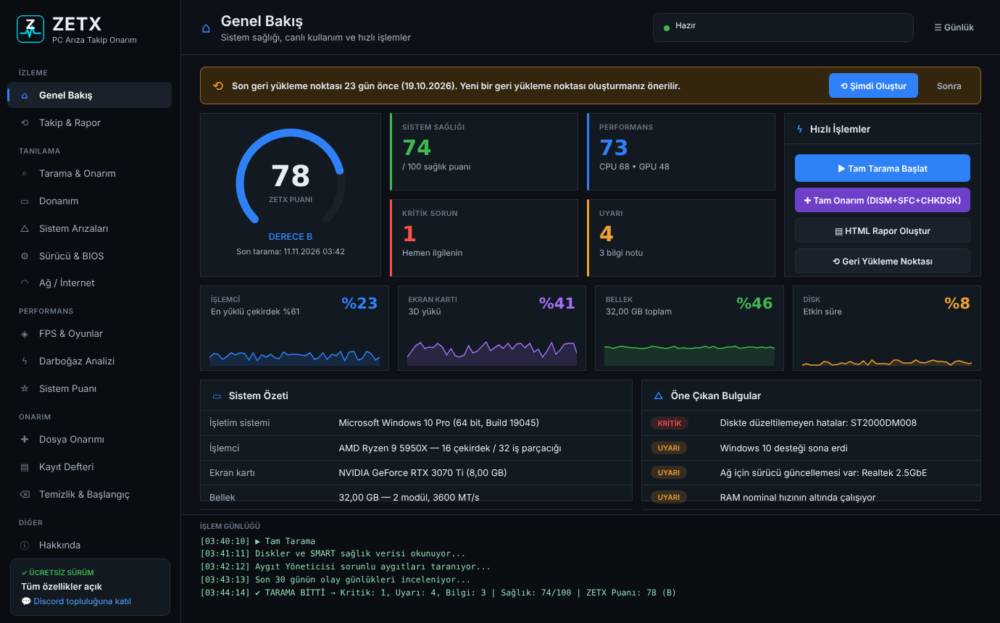
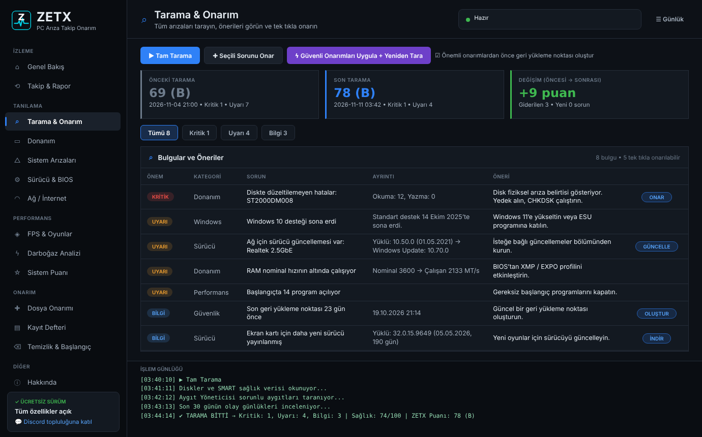
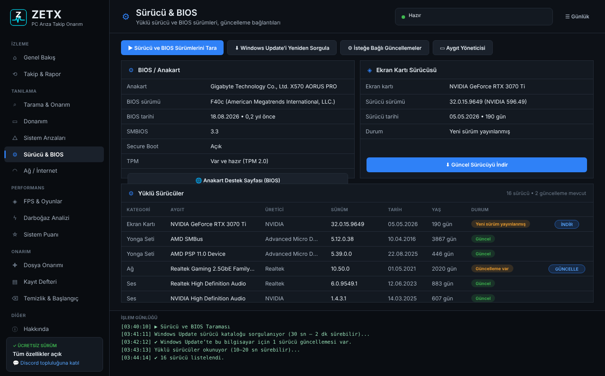
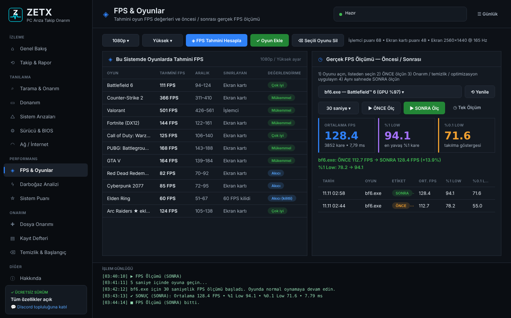
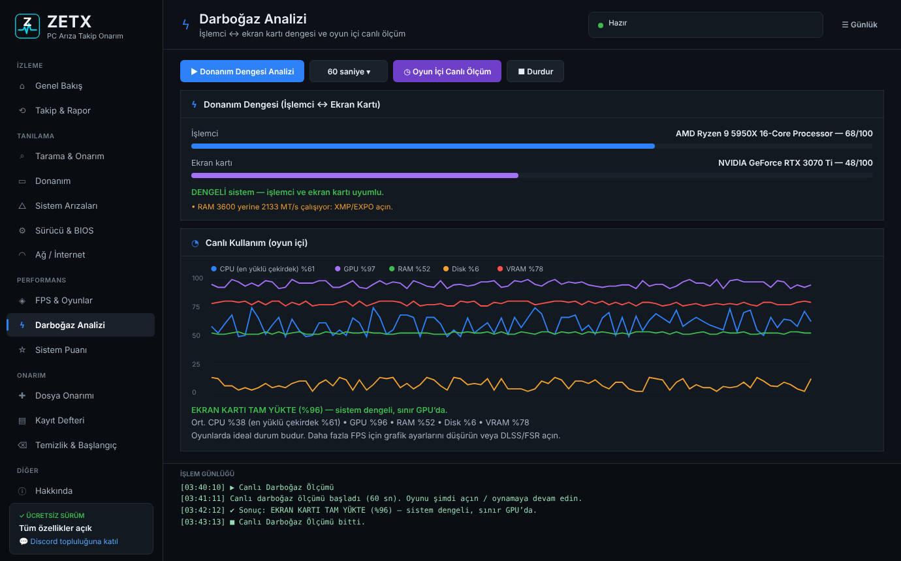

<p align="center">
  
</p>

<h1 align="center">ZETX PC Arıza Takip Onarım</h1>

<p align="center">
  <b>Ücretsiz</b> Windows arıza tespit ve onarım programı — donanım, sistem, sürücü/BIOS, kayıt defteri, darboğaz analizi, oyun FPS tahmini ve ölçümü.<br>
  <a href="https://github.com/wolkansezer/ZETX-PC-Ariza-Takip-Onarim/releases/latest/download/ZETX-PC-Ariza-Takip-Onarim-Setup.exe"><b>⬇ Kurulum dosyasını indir (Setup.exe)</b></a> •
  <a href="https://github.com/wolkansezer/ZETX-PC-Ariza-Takip-Onarim/releases">Tüm sürümler</a> •
  <a href="https://discord.gg/nvqc84AHZf">Discord</a>
</p>

<p align="center">
  
</p>

## Ekran Görüntüleri

| Tarama & Onarım | Sürücü & BIOS |
|:---:|:---:|
|  |  |
| **FPS & Oyunlar** | **Darboğaz Analizi** |
|  |  |

<sub>Görseller programın arayüzünü temsil eder; değerler örnektir ve her bilgisayarda farklıdır.</sub>

---

## Kurulum

1. **[ZETX-PC-Ariza-Takip-Onarim-Setup.exe](https://github.com/wolkansezer/ZETX-PC-Ariza-Takip-Onarim/releases/latest/download/ZETX-PC-Ariza-Takip-Onarim-Setup.exe)** dosyasını indirin ([Releases](https://github.com/wolkansezer/ZETX-PC-Ariza-Takip-Onarim/releases) sayfasında da bulunur).
2. Çalıştırın ve kurulum sihirbazını izleyin. Program, Başlat menüsüne ve isteğe bağlı olarak masaüstüne kısayol ekler.
3. Programı kısayoldan açın (yönetici izni ister).

> Kurulum dosyası dijital imzalı olmadığı için Windows "Windows bilgisayarınızı korudu" uyarısı gösterebilir. **Ek bilgi → Yine de çalıştır** ile devam edebilirsiniz.

Kurulumsuz kullanmak için depoyu indirip **BASLAT.bat** dosyasını çalıştırabilirsiniz.

**Gereksinim:** Windows 10 / 11 (64 bit). PowerShell 5.1 Windows ile hazır gelir; ek bir şey kurmanız gerekmez.

## Özellikler

| Bölüm | Neler yapar |
|---|---|
| **Genel Bakış** | ZETX puanı, canlı CPU / GPU / RAM / Disk göstergeleri, sistem özeti, öne çıkan bulgular, geri yükleme noktası önerisi |
| **Tarama & Onarım** | Tüm bulgular (Kritik / Uyarı / Bilgi), tek tıkla onarım, toplu güvenli onarım + yeniden tarama, önceki / son tarama karşılaştırması |
| **Donanım** | SMART disk sağlığı (sıcaklık, aşınma, hatalar), RAM modülleri (tek kanal, XMP), sorunlu aygıtlar, pil sağlığı, WHEA donanım hataları |
| **Sistem Arızaları** | Mavi ekran geçmişi ve çözümleri, ani kapanmalar, GPU sürücü çökmeleri, disk hataları, çöken programlar |
| **Sürücü & BIOS** | Sürücü sürümleri; "güncelleme var" yalnızca Windows Update'te gerçekten daha yeni sürücü bulunduğunda gösterilir. BIOS sürümü, Secure Boot, TPM |
| **Ağ / İnternet** | Ping, jitter, paket kaybı, DNS hızı, Wi-Fi sinyali, ağ sıfırlama, DNS değişimi |
| **FPS & Oyunlar** | 22 oyunda tahmini FPS (1080p / 1440p / 4K, Düşük → Ultra), kendi oyununu ekleme, Intel PresentMon ile **önce / sonra** gerçek FPS ölçümü |
| **Darboğaz Analizi** | İşlemci ↔ ekran kartı dengesi ve oyun içi canlı ölçüm |
| **Sistem Puanı** | ZETX genel puanı (S / A / B / C / D), WinSAT testleri |
| **Dosya Onarımı** | Tam Onarım, SFC, DISM, CHKDSK, Windows Update sıfırlama, WMI, simge önbelleği ve daha fazlası |
| **Kayıt Defteri** | Geçersiz girdiler (yedek alınarak temizlenir), tam yedek / geri yükleme, ele geçirme (hijack) kontrolü |
| **Temizlik & Başlangıç** | Gereksiz dosyalar, başlangıç programları, güç planı |
| **Takip & Rapor** | Tarama geçmişi, puan grafiği, HTML rapor, haftalık otomatik tarama |

Program kişisel verilerinizi hiçbir yere göndermez. Raporlar, tarama geçmişi ve yedekler `Belgeler\ZETX PC Ariza Takip` klasöründe tutulur.

## Depo yapısı

```
ZETX-PC-Ariza-Takip-Onarim.ps1   Derlenmiş, tek dosyalık program (BASLAT.bat bunu açar)
BASLAT.bat                       Kurulumsuz çalıştırma
EXE-OLUSTUR.bat / Build-EXE.ps1  ps2exe ile tek dosyalık EXE üretme (İndirilenler klasörüne)
kaynak/                          Kaynak kod: head.ps1 (başlangıç), core.ps1 (motor), ui.ps1 (arayüz)
derleme/build.py                 kaynak/ → tek dosyalık .ps1 derleyici
kurulum/                         Kurulum sihirbazı (NSIS) ve başlatıcı EXE (C) kaynakları
```

### Yeni sürüm yayınlama

`kaynak/core.ps1` içindeki `Version` değerini artırıp `main` dalına gönderin. GitHub Actions Setup.exe'yi kaynaktan derler ve **Releases** sayfasına `v<sürüm>` olarak yükler.

### Elle derleme

```bash
python derleme/build.py                       # ZETX-PC-Ariza-Takip-Onarim.ps1 oluşturur
x86_64-w64-mingw32-windres kurulum/app.rc -O coff -o kurulum/app.res
x86_64-w64-mingw32-gcc -O2 -municode -mwindows kurulum/launcher.c kurulum/app.res -lshlwapi -o "kurulum/ZETX PC Ariza Takip Onarim.exe" -s
cp ZETX-PC-Ariza-Takip-Onarim.ps1 kurulum/ && cd kurulum && makensis setup.nsi   # Setup.exe
```

## Destek

Soru, öneri ve hata bildirimleri için: **[Discord](https://discord.gg/nvqc84AHZf)** • **[E-posta](mailto:volkan.sezer@outlook.com.tr)**

Sorun bildirirken `Belgeler\ZETX PC Ariza Takip\Kayitlar\hata-kaydi.log` dosyasını eklerseniz çözüm hızlanır.

---

<p align="center">© Volkan Sezer — ZETX / ZETXTV. Ücretsiz yazılımdır, tüm hakları saklıdır.</p>
